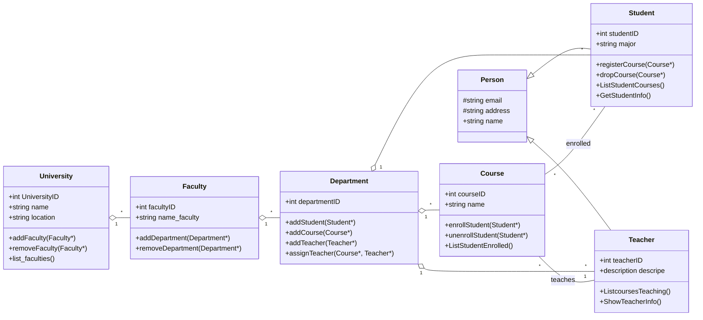

<div align="center">


# Universities Manager

**An object-oriented model of a university, from campus down to the classroom, written in C++.**


</div>

---

## Overview

Universities Manager is my **Object Oriented Programming** final project (2nd year, Cyber Security, Ar-Rasheed University). The goal was to design a class diagram for a real-world domain **first**, then implement it faithfully in C++.

The model covers seven classes and the relationships between them:
**University → Faculty → Department → Course**, with **Student** and **Teacher** both inheriting from **Person**.

## Class diagram



The original UML diagram submitted with the project is in [`docs/uml-class-diagram.pdf`](docs/uml-class-diagram.pdf), and the full write-up is in [`docs/documentation.docx`](docs/documentation.docx).

## OOP concepts applied

| Concept | Where |
|---|---|
| **Encapsulation** | `Person` keeps `email` and `address` `protected`. I changed this from public in the diagram, since private data shouldn't be exposed |
| **Inheritance** | `Student` and `Teacher` extend `Person` |
| **Composition / aggregation** | Each level holds a `vector<T*>` of the level below it |
| **Static members** | `static` counters assign unique, auto-incrementing IDs per class |
| **Bidirectional links** | Enrolling a student updates both `Student::coursesEnrolled` and `Course::studentsEnrolled` |
| **Forward declarations** | Let mutually-referencing classes compile in a single file |

## Run it

```bash
g++ -std=c++11 UniversitiesManager.cpp -o universities-manager
./universities-manager
```

`main()` builds a small demo world: one faculty, a *cyber* department, two courses, two students and a teacher. It then registers students and assigns the teacher, printing each step.

## What I'd do differently today

This is a 2nd-year project, kept as submitted. Looking back:

- `viewStudentGrades()` was planned but never implemented.
- Raw pointers everywhere. Today I'd use references or `std::shared_ptr`/`weak_ptr` for the back-links.
- Everything lives in one file. Splitting it into a header and source file per class would make it easier to maintain.
- No interactive menu. The demo scenario is hard-coded in `main()`.

## Author

**Humam Al-Dhubhani** · [GitHub](https://github.com/humamaldhubhani)

<sub>Released under the [MIT License](LICENSE).</sub>
